# ambientCG: Paving Stones materials

**23 assets from [ambientCG](https://ambientcg.com), dedicated to the public domain under [CC0](https://docs.ambientcg.com/license/).** Use them in any game, free or paid, and change them however you like; no credit is needed.

PBR materials as 1K and 2K JPG maps (colour, normal GL and DX, roughness, AO, displacement), one folder per resolution. 870.2 MB in all.

This is a copy kept by [zuujis-cc0](https://github.com/zuujis-cc0) so game makers can take single files from GitHub. It is not made by or affiliated with ambientCG: the originals, often in more formats and higher resolutions, are on [ambientcg.com](https://ambientcg.com). If they help you, consider [supporting ambientCG](https://www.patreon.com/ambientCG).

Every file is listed in [MANIFEST.tsv](MANIFEST.tsv) with its size and SHA-256. More free assets: [the Zuujis collection](https://github.com/zuujis-cc0/free-game-assets#readme).

| | | | |
| :-: | :-: | :-: | :-: |
| <a href="PavingStones116">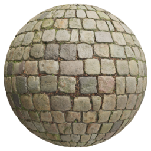</a> <b><a href="PavingStones116">Paving Stones 116</a></b> by ambientCG · <a href="https://ambientcg.com/a/PavingStones116">source</a> | <a href="PavingStones117">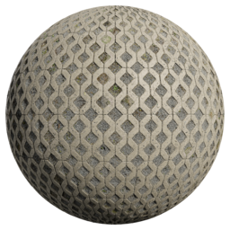</a> <b><a href="PavingStones117">Paving Stones 117</a></b> by ambientCG · <a href="https://ambientcg.com/a/PavingStones117">source</a> | <a href="PavingStones118">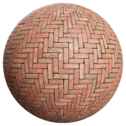</a> <b><a href="PavingStones118">Paving Stones 118</a></b> by ambientCG · <a href="https://ambientcg.com/a/PavingStones118">source</a> | <a href="PavingStones119">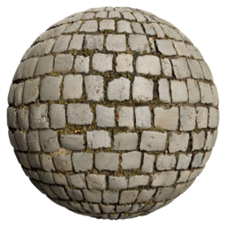</a> <b><a href="PavingStones119">Paving Stones 119</a></b> by ambientCG · <a href="https://ambientcg.com/a/PavingStones119">source</a> |
| <a href="PavingStones120">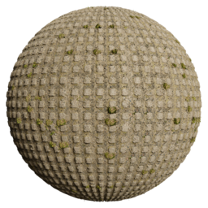</a> <b><a href="PavingStones120">Paving Stones 120</a></b> by ambientCG · <a href="https://ambientcg.com/a/PavingStones120">source</a> | <a href="PavingStones121">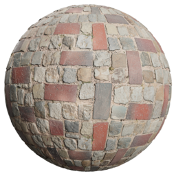</a> <b><a href="PavingStones121">Paving Stones 121</a></b> by ambientCG · <a href="https://ambientcg.com/a/PavingStones121">source</a> | <a href="PavingStones122">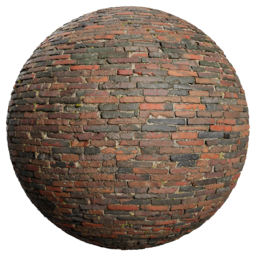</a> <b><a href="PavingStones122">Paving Stones 122</a></b> by ambientCG · <a href="https://ambientcg.com/a/PavingStones122">source</a> | <a href="PavingStones123">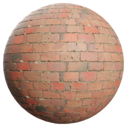</a> <b><a href="PavingStones123">Paving Stones 123</a></b> by ambientCG · <a href="https://ambientcg.com/a/PavingStones123">source</a> |
| <a href="PavingStones124">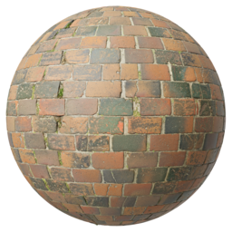</a> <b><a href="PavingStones124">Paving Stones 124</a></b> by ambientCG · <a href="https://ambientcg.com/a/PavingStones124">source</a> | <a href="PavingStones125A">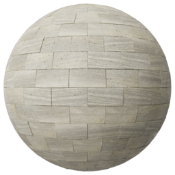</a> <b><a href="PavingStones125A">Paving Stones 125 A</a></b> by ambientCG · <a href="https://ambientcg.com/a/PavingStones125A">source</a> | <a href="PavingStones125B">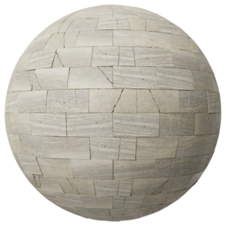</a> <b><a href="PavingStones125B">Paving Stones 125 B</a></b> by ambientCG · <a href="https://ambientcg.com/a/PavingStones125B">source</a> | <a href="PavingStones126A">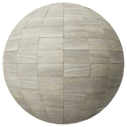</a> <b><a href="PavingStones126A">Paving Stones 126 A</a></b> by ambientCG · <a href="https://ambientcg.com/a/PavingStones126A">source</a> |
| <a href="PavingStones126B">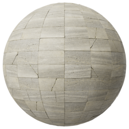</a> <b><a href="PavingStones126B">Paving Stones 126 B</a></b> by ambientCG · <a href="https://ambientcg.com/a/PavingStones126B">source</a> | <a href="PavingStones127">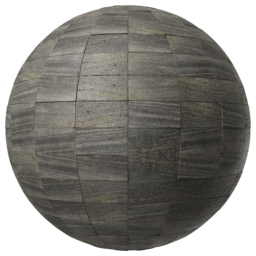</a> <b><a href="PavingStones127">Paving Stones 127</a></b> by ambientCG · <a href="https://ambientcg.com/a/PavingStones127">source</a> | <a href="PavingStones128">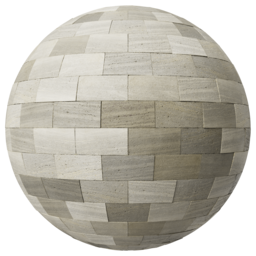</a> <b><a href="PavingStones128">Paving Stones 128</a></b> by ambientCG · <a href="https://ambientcg.com/a/PavingStones128">source</a> | <a href="PavingStones129">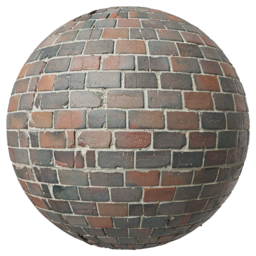</a> <b><a href="PavingStones129">Paving Stones 129</a></b> by ambientCG · <a href="https://ambientcg.com/a/PavingStones129">source</a> |
| <a href="PavingStones130">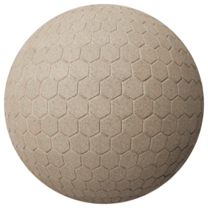</a> <b><a href="PavingStones130">Paving Stones 130</a></b> by ambientCG · <a href="https://ambientcg.com/a/PavingStones130">source</a> | <a href="PavingStones131">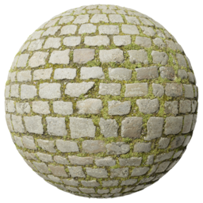</a> <b><a href="PavingStones131">Paving Stones 131</a></b> by ambientCG · <a href="https://ambientcg.com/a/PavingStones131">source</a> | <a href="PavingStones132">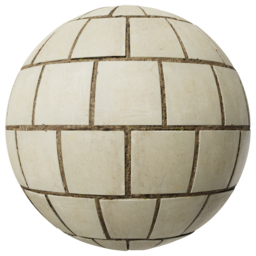</a> <b><a href="PavingStones132">Paving Stones 132</a></b> by ambientCG · <a href="https://ambientcg.com/a/PavingStones132">source</a> | <a href="PavingStones133">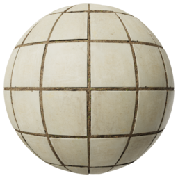</a> <b><a href="PavingStones133">Paving Stones 133</a></b> by ambientCG · <a href="https://ambientcg.com/a/PavingStones133">source</a> |
| <a href="PavingStones134">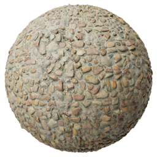</a> <b><a href="PavingStones134">Paving Stones 134</a></b> by ambientCG · <a href="https://ambientcg.com/a/PavingStones134">source</a> | <a href="PavingStones135">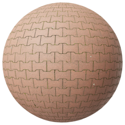</a> <b><a href="PavingStones135">Paving Stones 135</a></b> by ambientCG · <a href="https://ambientcg.com/a/PavingStones135">source</a> | <a href="PavingStones136">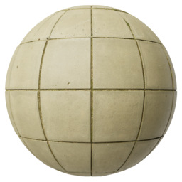</a> <b><a href="PavingStones136">Paving Stones 136</a></b> by ambientCG · <a href="https://ambientcg.com/a/PavingStones136">source</a> |  |

---

Kept up to date by this repository's own [update workflow](.github/workflows/update.yml), with code and plan from [cc0-mirror](https://github.com/zuujis-cc0/cc0-mirror). Something wrong? [Open an issue there](https://github.com/zuujis-cc0/cc0-mirror/issues/new) or use the [private report form](https://games.zuujis.com/report).
